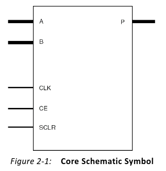
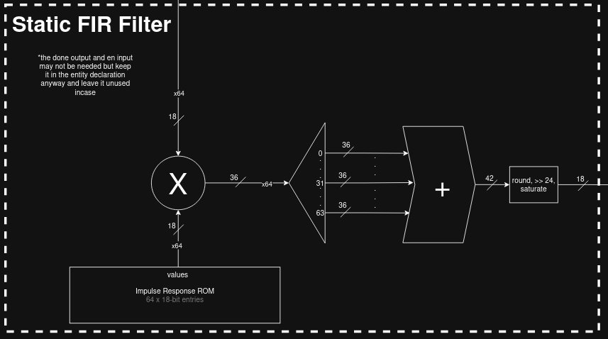
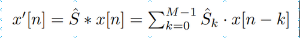
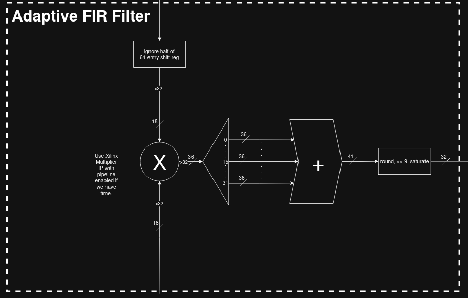
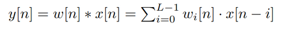
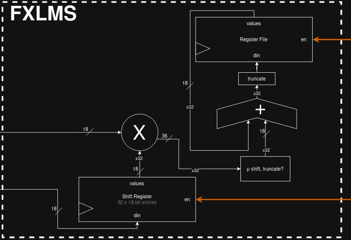
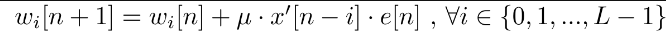

# Terminology / Preamble
Every 64 BCLKS, a full period of WS passes (because WS = BCLK / 64). This will be denoted as a **frame**.

We will denote a reference sample as **x**, an error sample as **e**, and the anti-noise output as **y**.

Currently L = 32, M = 64. This will probably change, so **ensure your entities use these as generics**. These are used to represent the amount of delay elements (e.g history of samples via shift registers) that are required in convolution.

Within a frame, when WS = 0, the I2S master samples **both** the error and reference microphones and deserializes the bits provided by each microphone. When it is done deserializing, it will assert **err_w_stb** and **ref_w_stb** simultaneously. These technically have the exact same behaviour, but for adaptability we will keep them as 2 distinct outputs from I2S master.

Whenever you require multiplication, it can be done using the below multipler IP provided by AMD. **The IP provides an option to enable pipelining. make sure that it is to maximise clk frequency**. the multiplier mu can probably be implemented using a simple shift-right to divide the value, but check first.

https://docs.amd.com/api/khub/documents/idOj3Pp9ocZdMoFz3IpkjQ/content

# How the Control System Works
This file outlines how the control system works cuz its lowkey complex asf.

So far, we are envisioning the operation as follows.
1. I2S master strobes the reference and error sample in the sample time instant

2. FSM in the control system sees that strobe, asserts en to bring ref into a shift register, and err into a standalone register (for pipelining, anticipating that the net path from i2s_master and the cs will be long so we wanna minimize CPL).

3. Now, 2 things happen in parallel

    **Updating FXLMS Weightings**

    1. The Static FIR filter convolves x with the secondary path coefficients, and outputs it as x'[n]. This will take multiple clock cycles cuz the multiplication / convolution will have to be pipelined.

    2. The FXLMS block takes **x'[n]**, and performs a calculation with the error signal **e[n]** and the previous weightings **w[n]** to get new weightings **w[n + 1]** for the Adaptive FIR filter. Note that the FXLMS block will have to wait a few clk cycles for **x'[n]** to be updated by the Static FIR, but the FSM handles this by gating the shift register used in the FXLMS (this is explained below in more detail). Note that these new weightings **w[n + 1]** will NOT be given to the adaptive FIR filter, it will use **w[n]** per the formula (see below).

    3. FSM opens weight register to let **w[n + 1]** weightings in for the next timestep to use. Note that these needs to occur on.

    **Calculating Anti-Noise Signal**

    1. The Adaptive FIR filter uses the weightings **w[n]**, NOT **w[n + 1]** from the FXLMS block, and convolves it with the reference signal **x[n]** to get **y[n]**.

    3. FSM opens register and latches Adaptive FIR output. This needs to happen before or at the same time the weight register is opened, otherwise the filter may convolve **x[n]** with **w[n + 1]**.

    2. Speaker outputs anti-noise signal **y[n]**

4. system waits until the next ref and err sample appears, goto step 1.

Addition can be performed through a typical adder. If the addition is super big, try and pipeline it. We have alot of clock cycles so it shouldn't be a problem. 

## Static FIR filter

This just convolves the reference sample **x[n]** with the secondary path estimate S^ to give **x'[n]**. Note that this should be generic as M, not 64, since M is the amount of taps in the Static FIR. Ensure that multiplication is pipelined. I am not sure on the mathematics behind it, but **x'[n]** is needed for the gradient descent the FXLMS performs (updating the weightings to reduce the amplitude of the error signal in the next pass).

## Adaptive FIR filter

This just calculates the anti-noise signal to output to the speakers. it convolves x with the weightings by performing the calculation below. the Adaptive FIR filter will receive a 64-entry array with 18-bit entries, denoting **x[n]**, **x[n-1]**, **x[n - 2]**, ... , **x[n - M - 1]**. Only use the first L indexes (0 - L - 1) from the array. It will also receive a L-entry array with 18-bit weightings. These should be convolved using the formula below. An outline of what it might look like is shown above.

The FSM will gate the adaptive FIR's output to a **y[n]** register so the speaker can continuous read off the anti-noise signal. you dont have to worry about that directly, the FSM handles that, but just good to know lel.

## FXLMS Block

This provides the weights that the Adaptive FIR reads off and convolves with the input samples.
It generates a 32-entry buffer of 18-bit weights, which will be stored in a **register file**. I *think* (double check) that you can assume that all these weightings start at 0. Either way the system should converge and update them.

To calculate the 18-bit weights, the FXLMS needs to perform **gradient descent** on each weighting entry i (there are L of them), the formula
for which is denoted above. for each weight entry, this essentially just updates them in response to the error value sampled by the microphone, and modifies
the weightings to oppose the remaining noise in the error signal (cancelling residue noise). This calculation also requires x', a filtered version of the
x input that the Static FIR filter calculates and outputs (which you can see feeds into the `din` of the shift reg above). 

Because there are L weightings and this formula is applied element-wise, we also need a L-entry **history of x'** for each weight (**x'[n], x'[n - 1], ..., x'[n-31]**). This is what the **L-entry shift register** for.
It just acts as a rolling buffer to track previous x' so the formula can be applied to each element. Note that the error signal **e[n]** does not require a history. each element-wise calculation uses the same, current **e[n]** that 
the i2s_master is giving to the FXLMS. Note that this shift register is gated by the FSM, and will assert the `en` signal when the Static FIR is done calculating **x'[n]**.

From what we can see so far, the only multiplication that needs to be done here is between **x'[n]** and the error signal **e[n]**. the mu value can just be implemented as a right-shift, just make sure to handle sign extension if needed. You will have to figure out how to get the output of each weighting down to 18-bits, cuz thats what the Adaptive FIR expects.

