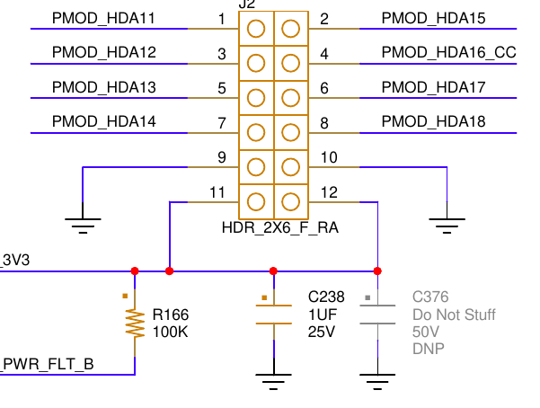

# Port Mappings for PMOD J2
|Name | PMOD Port | Pin |
| :--- | :--- | :---: |
| lrcl | 1 | H12 |
| ref_dout | 2  | B10 |
| err_dout | 3 | E10 |
| amp_din | 4 | E12 |
| bclk | 5 | D10 |
| VCC | 11, 12 | |
| GND | 9, 10 | |

