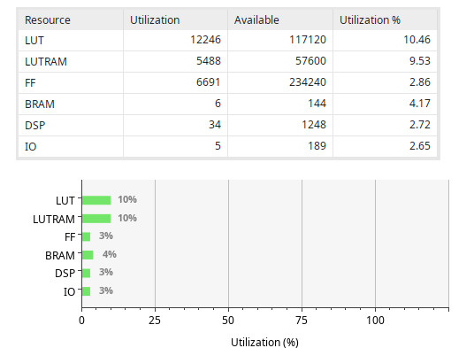
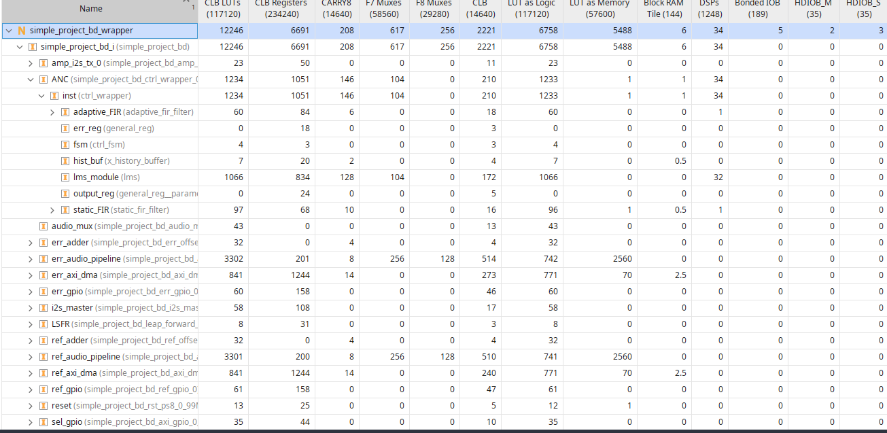

DSP primarily comes from LMS, as it computes weights in parallel for 32-taps as opposed to MAC-based.
LUT usage comes from FIFOs inside audio_pipeline. **this should be improved to use BRAM**.
FF usage comes from DMAs, smartconnect, and FXLMS.