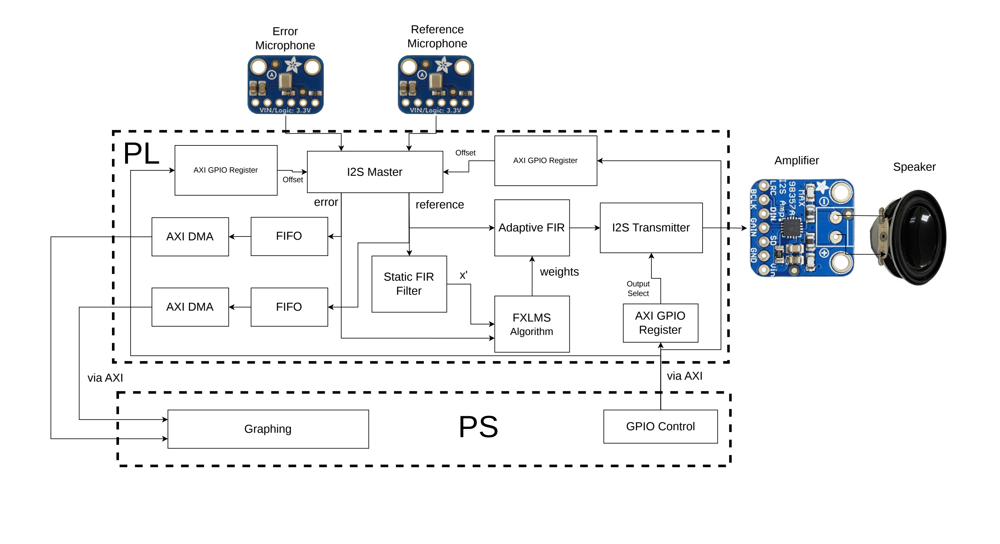
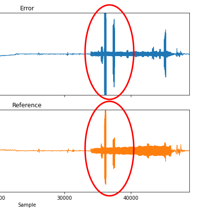

# Active Noise Cancelling!

This .md file provides documentation on how to use the .zip file, including file hierarchy, constraints, relevant block diagrams, etc.

# Overview, Functionality

> What is it?

> Why did we do it (just copy from group plan)

> Current functionality summary ( good things 2 mention here might be like each major part, so AXI GPIO Offset Control, AXI GPIO MUX Control, Graphing, Control System, Simultaneous Sampling, etc)

# Diagrams

A series of `.pdf` diagrams are located in `/diagrams`. These can be viewed at your leisure to understand how the system works and how everything interfaces. 
> These are also depicted below, but for clarity please view them as pdfs.

### External Circuit

`external_circuit.pdf` visualises the external circuit required to interface the speaker and microphones with PL through the KV260's PMOD Port.

### Block Diagrams

`simplified_block_diagram.pdf` Shows a high-level overview of each major component in the system, and connections between PS-PL.

`full_block_diagram.pdf` shows a more in-depth overview of how the system and PL-PS interface works, modelling each module, major component, and its I/O ports. Some less-important modules such as **reset** have been omitted to reduce clutter.

`vivado_block_diagram.pdf` shows the Vivado render of the PL as a diagram. This contains the most detail, and is the final source of truth on the underlying functionality of the PL.

# Project Structure, Hierarchy

The project is structured as follows.

> INSERT IMAGE / ASCII OF FILE TREE HERE.

## PL

The Vivado build, aswell as the custom constraints file.

> talk about structure, including each file? also maybe have the .xdc file in a seperate folder aswell as in the vivado hierachy so the markers can easily see it.

## PS

> Include `.bit`, `.hwh`, and jupyter notebook that is CLEAN (clear any output cells) in the directory.

# Dependencies

> mention pip installing dependencies if needed

> look at dependencies in the PS code

# Building

> Show how to export via Export Hardware...

# Testing and Verifying

> It should be noted that the system can still be technically run via Jupyter Notebook without the external circuit, however it **will not work** and read garbage values on the PS.

> Ensure that PL.reset() in PS code is commented / uncommented depending on if a cache exists.

> Ensure that the graph is showing, and not weird values...

> Show graph when PMOD is disconnected...

> Show graph when mics are not wired correctly...

> you can switch the MUX value by editing...

> you can change the offsets by editing...

> you can see if its working by if its showing a weird reduction.

# Limitations, Incomplete Features, Special Considerations

The system's control system can become unstable due to vibrations, and can disrupt the cancellation. This appears as loud clicks or ringing from the speaker that can be seen below in the PS graphing as large spikes. This is to be expected by the user in the current system state.

The system will NOT work with the standard PMOD Expansion PCB provided by the courseware. It uses the custom constraints file `kria-constraints-custom.xdc`, and requires a custom circuit. 

> See **External Circuit** under **Diagrams** for details on this.

82Ω resistors are used as termination resistors within the external circuit to prevent reflection. Any resistance between 50 - 120Ω is recommended per the 
SPH0645LM4H-B datasheet at https://cdn-shop.adafruit.com/product-files/3421/i2S+Datasheet.PDF.

**These should be as close as possible the source of the signal.**

> For example as close to the PMOD port for BCLK and LRCL, as the KV260 generates them. 

> See **External Circuit** under **Diagrams** for details on where to place them.