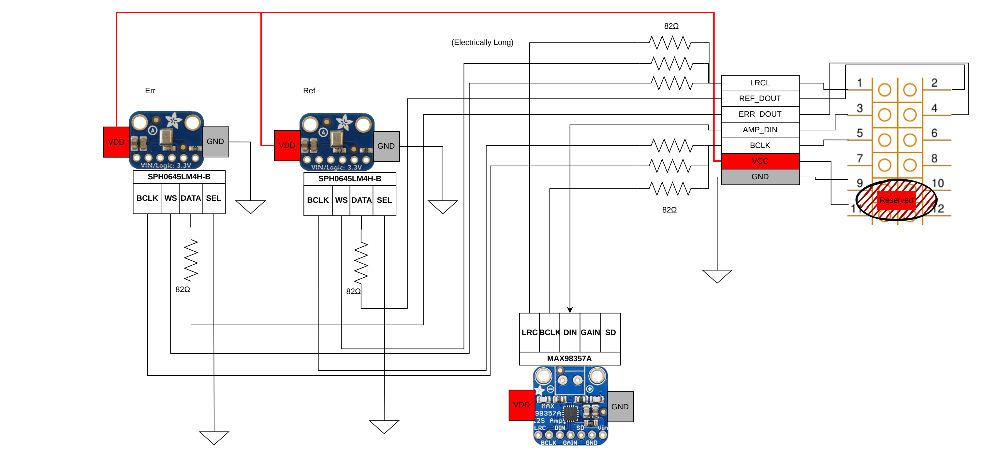
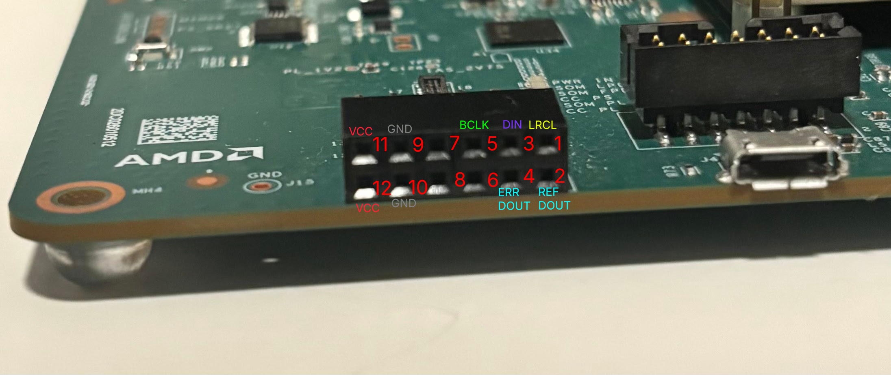
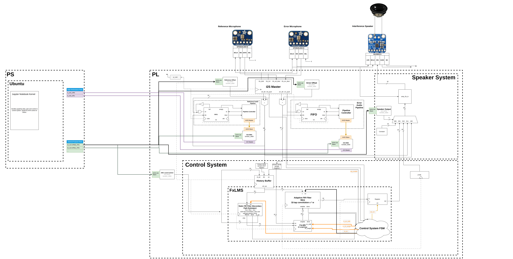
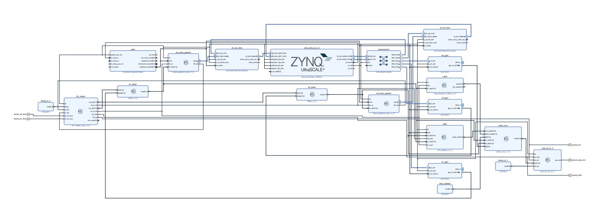

# Active Noise Cancelling!

This .md file provides documentation on how to use the .zip file, including file hierarchy, constraints, relevant block diagrams, etc.

# Overview, Functionality

This project explores our implementation of Active Noise Cancellation (ANC) using a PVC pipe as an isolated acoustic environment. The system uses an upstream reference microphone, an error microphone and a speaker to create a general noise cancelling system.

ANC is a technology proven to be useful in improving concentration, wellbeing and accessibility. Modern ANC technology is expensive and often restricted to devices such as headphones. Alternatively, passive noise cancellation can also be expensive and time consuming to deploy.

We have prototyped an electronic ANC system that combines the best of these technologies, with the aim of developing a solution for noise cancellation on a large scale, while remaining cheap and easy to set up.

This has many use cases, including:
- Cutting out interfering ambient noise from workplace meetings, office spaces, and classrooms to aid productivity and focus

- Usage in homes and bedrooms to reduce outside noise (e.g on busy roads) and improve wellbeing

- Improving accessibility for people with neurological disorders such as Autism Spectrum Disorder (ASD), ADHD, or sleep disorders, who struggle with sensory overload in noisy environments.

## Functional Summary
The system is controlled in PS using AXI GPIO to adjust microphone DC offsets, and change the output of the speaker. The ANC algorithm uses Filtered-X Least Mean Squares (FxLMS) to create the destructive wave. The algorithm is implemented entirely in PL.

The reference and error microphones are sampled simultaneously using two audio pipelines are used, one for each of the reference and error mics. The audio pipelines are used to send the microphone samples to PS for graphing.

The reference and error mic samples are supplied to the control system. The reference mic captures the incoming noise, and the error mic measures residual noise. Using these signals, the FxLMS algorithm updates its weights and calculates the resulting anti-noise signal. The calculated signal is sent to the speaker, producing a wave to destructively interfere with the incoming noise.

# Diagrams

A series of `.pdf` diagrams are located in `/diagrams`. These can be viewed at your leisure to understand how the system works and how everything interfaces. 
> These are also depicted below, but for clarity please view them as pdfs.

### External Circuit

`external_circuit.pdf` visualises the external circuit required to interface the speaker and microphones with PL through the KV260's PMOD Port.



The following diagram outlines how to connect each port on the KV260's PMOD port. 
> Please note that pins 6, 7, 8 are unused.



### Block Diagrams

`simplified_block_diagram.pdf` Shows a high-level overview of each major component in the system, and connections between PS-PL.


`full_block_diagram.pdf` shows a more in-depth overview of how the system and PL-PS interface works, modelling each module, major component, and its I/O ports. Some less-important modules such as **reset** have been omitted to reduce clutter.



`vivado_block_diagram.pdf` shows the Vivado render of the PL as a diagram. This contains the most detail, and is the final source of truth on the underlying functionality of the PL.



# Project Structure, Hierarchy

The project is structured as follows.

> INSERT IMAGE / ASCII OF FILE TREE HERE.


## PL

The Vivado build, aswell as the custom constraints file. All PL source lives in `hw/`. The Vivado project itself is **not** included, as it is generated from these files by `create_project.tcl` (see **Building**).

```
hw/
├── create_project.tcl        <- rebuilds the whole Vivado project from source
├── simple_project_bd.pdf     <- printout of the block design
├── bd/                       <- block design scripts (bd.tcl is the final one used)
├── ip/                       <- Xilinx IP (.xci) imported by create_project.tcl (multipliers)
├── modules/                  <- all hand-written VHDL source for the PL
├── tests/
│   ├── vivado_tb/            <- Vivado testbenches
│   └── cocotb/               <- cocotb (Python) testbenches
├── constraint/               <- constraints files (.xdc)
└── build/vivado/             <- GENERATED Vivado project (created by create_project.tcl)
```

### Constraints

| Signal | PMOD pin | FPGA pin |
|---|---|---|
| `pmod_lrcl` (word select, both mics + amp) | 1 | H12 |
| `pmod_ref_dout` (reference mic data) | 2 | B10 |
| `pmod_amp_din` (amplifier data) | 3 | E10 |
| `pmod_err_dout` (error mic data) | 4 | E12 |
| `pmod_bclk` (bit clock, both mics + amp) | 5 | D10 |
| VCC / GND | 11, 12 / 9, 10 | |

### Block Design

`bd.tcl` contains the block diagram `simple_project_bd` used in . The main blocks are:

| Block (instance name) | Type | Purpose |
|---|---|---|
| `zynq_ultra_ps_e_0` | Zynq UltraScale+ PS | provides `pl_clk0` (100 MHz), reset and the AXI ports |
| `i2s_master` | `i2s_master_new.vhd` | generates BCLK / LRCLK, samples both mics in the same frame |
| `err_adder`, `ref_adder` | `offset.vhd` | add a PS-controlled value to each mic sample to remove its DC offset |
| `err_gpio`, `ref_gpio` | AXI GPIO (32-bit, outputs) | offset values written from the notebook |
| `ANC` | `ctrl_wrapper.vhd` | the control system: history buffer, static FIR (Ŝ), FxLMS, adaptive FIR, FSM |
| `LSFR` | `Leap_Forward_LFSR.vhd` | white-noise generator, used to measure Ŝ |
| `audio_mux` | `audio_mux.vhd` | selects what the speaker plays |
| `sel_gpio` | AXI GPIO (3-bit, outputs) | MUX select written from the notebook |
| `amp_i2s_tx_0` | `amp_i2s_tx.vhd` | I2S transmitter to the MAX98357A |
| `err_audio_pipeline`, `ref_audio_pipeline` | `audio_pipeline_new.vhd` | FIFO + AXI-Stream packets of mic samples |
| `err_axi_dma`, `ref_axi_dma` | AXI DMA (S2MM) | stream both mics to PS memory for graphing |
| `smartconnect`, `reset` | AXI SmartConnect, Processor System Reset | AXI-Lite routing to the DMAs / GPIOs, synchronised reset |


### Modules

| File | Description |
|---|---|
| `constants.vhd` | shared package: sample widths, **M = 1024** (Ŝ taps), **L = 32** (adaptive taps), `M_BITS` / `L_BITS`, and the MUX select codes |
| `i2s_master_new.vhd` | I2S master for both SPH0645 mics. BCLK = 3.125 MHz, 64 BCLK per frame (fs = 48 828 Hz). Captures the reference and error samples together and pulses `ref_w_stb` / `err_w_stb` once per sample |
| `amp_i2s_tx.vhd` | I2S transmitter for the MAX98357A. Sends the 24-bit sample MSB-first, one BCLK after each LRCLK edge |
| `offset.vhd` | adds the 32-bit offset from `err_gpio` / `ref_gpio` to the mic sample (DC offset removal) |
| `audio_mux.vhd` | 5-input speaker source selector, controlled by `sel_gpio` |
| `Leap_Forward_LFSR.vhd` | 31-bit leap-forward LFSR (x³¹ + x³ + 1), 16 new bits per sample. Produces white noise for Ŝ measurement |
| `audio_pipeline_new.vhd`, `fifo.vhd` | buffer mic samples and send them as AXI-Stream packets (256 words) to the DMAs |
| `ctrl_wrapper.vhd` | top level of the control system (block `ANC`), connects all modules below |
| `ctrl_fsm.vhd` | sequences one sample: store x[n] and e[n] → run static FIR → shift x′ into LMS → update weights → latch y[n] |
| `extract_sample_18.vhd` | takes the 18 valid bits out of a 32-bit I2S word |
| `general_reg.vhd` | generic enabled register (error sample, output y[n]) |
| `x_history_buffer.vhd` | circular buffer of the last M = 1024 reference samples. `rd_ptr = k` returns x[n−k] one clock later |
| `static_fir_filter.vhd` | secondary-path estimate: x′[n] = Σ Ŝ[k]·x[n−k] over 1024 taps. The measured Ŝ is stored in ROM ×2¹⁸. One multiply-accumulate per clock on `mult_gen_0` (3-stage pipeline), ~1028 clocks per sample, output shifted right by 18 |
| `lms.vhd` | FxLMS weight update for the 32 weights: w ← w − (e·x′ >> 10). Computes all 32 updates in parallel (this is where most DSP usage comes from) |
| `adaptive_fir_filter.vhd` | anti-noise y[n] = Σ w[i]·x[n−i] over L = 32 taps, using `mult_gen_1` (18 × 26) |

### IP 

| IP | Settings | Used by |
|---|---|---|
| `mult_gen_0` | Multiplier 12.0, signed 18 × 18, Use Mults (DSP48), 3 pipeline stages | `static_fir_filter` |
| `mult_gen_1` | Multiplier 12.0, signed 18 × 26, Use Mults (DSP48), 3 pipeline stages | `adaptive_fir_filter` |

### MUX Select
MUX select values (from `constants.vhd`) used to drive the speaker output:

| `sel_gpio` value | Speaker plays |
|---|---|
| 0 (`NO_NOISE`) | nothing |
| 1 (`ANTI_N`) | anti-noise from the control system |
| 2 (`WHITE_N`) | white noise from the LFSR |
| 3 (`REF_MIC`) | reference mic  |
| 4 (`ERR_MIC`) | error mic  |

## PS

> Include `.bit`, `.hwh`, and jupyter notebook that is CLEAN (clear any output cells) in the directory.


# Dependencies

> mention pip installing dependencies if needed

> look at dependencies in the PS code

# Building


### Requirements
- **Vivado 2024.1**

### 1. Open or create the Vivado project

**Recreate it from source** In Vivado, either:
- **Tools → Run Tcl Script** and select `hw/create_project.tcl`

The script:
1. creates the project `anc` in `hw/build/vivado/`
2. adds every `.vhd` in `hw/modules/`, the constraints in `hw/vivado/`, and the testbenches in `hw/tests/vivado_tb/`
3. imports and generates the multiplier IP from `hw/ip/` (`mult_gen_0`, `mult_gen_1`)
4. rebuilds the block design from `hw/bd/bd.tcl`, creates its HDL wrapper and sets `simple_project_bd_wrapper` as top

# Testing and Verifying

> It should be noted that the system can still be technically run via Jupyter Notebook without the external circuit, however it **will not work** and read garbage values on the PS.


> Ensure that PL.reset() in PS code is commented / uncommented depending on if a cache exists.

> Ensure that the graph is showing, and not weird values...

> Show graph when PMOD is disconnected...

> Show graph when mics are not wired correctly...

> you can switch the MUX value by editing...

> you can change the offsets by editing...

> you can see if its working by if its showing a weird reduction.


# Limitations, Incomplete Features, Special Considerations

The system's control system can become unstable due to vibrations, and can disrupt the cancellation. This appears as loud clicks or ringing from the speaker that can be seen below in the PS graphing as large spikes. This is to be expected by the user in the current system state.


The system will NOT work with the standard PMOD Expansion PCB provided by the courseware. It uses the custom constraints file `kria-constraints-custom.xdc`, and requires a custom circuit. 

> See **External Circuit** under **Diagrams** for details on this.

82Ω resistors are used as termination resistors within the external circuit to prevent reflection. Any resistance between 50 - 120Ω is recommended per the 
SPH0645LM4H-B datasheet at https://cdn-shop.adafruit.com/product-files/3421/i2S+Datasheet.PDF.

**These should be as close as possible the source of the signal.**

> For example as close to the PMOD port for BCLK and LRCL, as the KV260 generates them. 

> See **External Circuit** under **Diagrams** for details on where to place them.